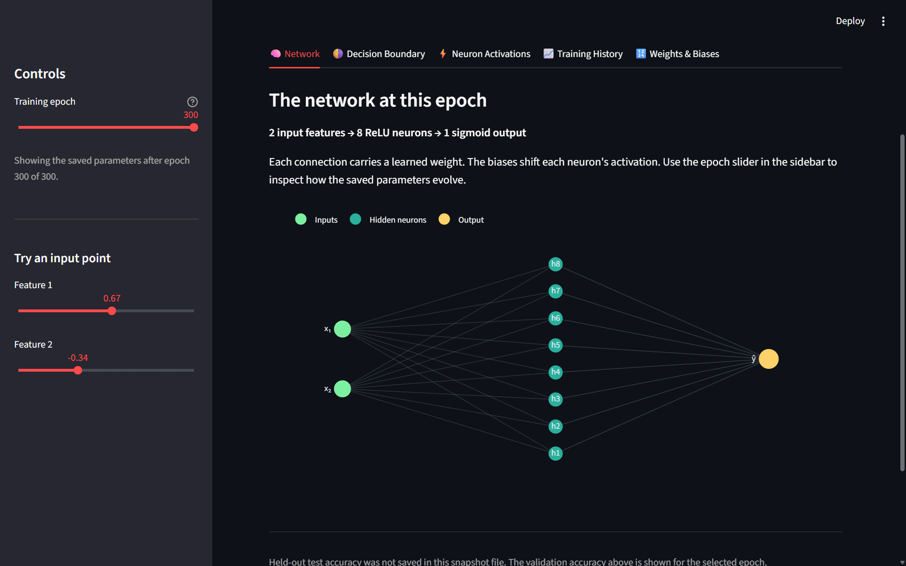
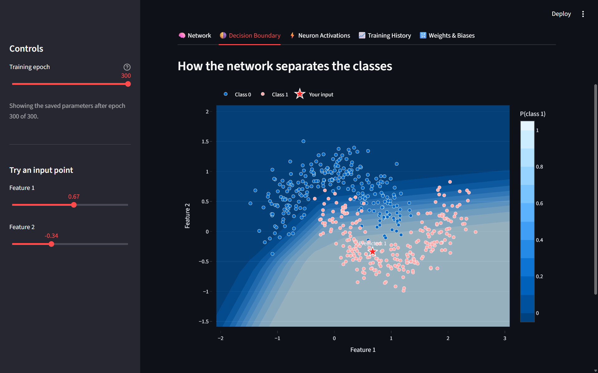
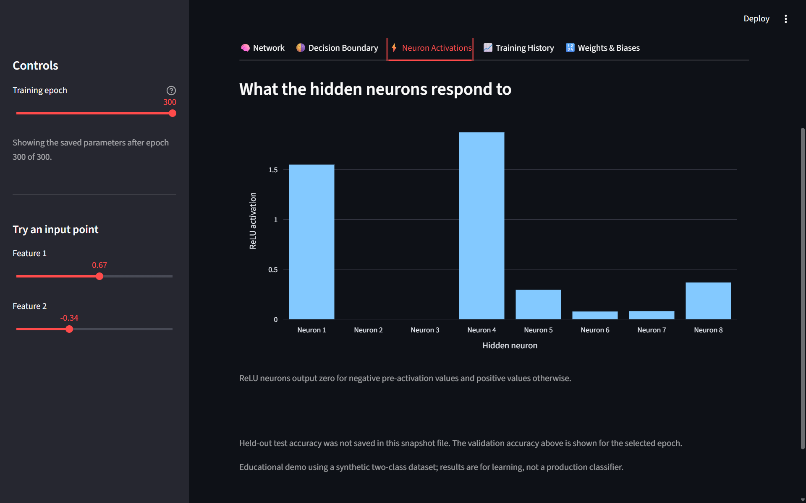
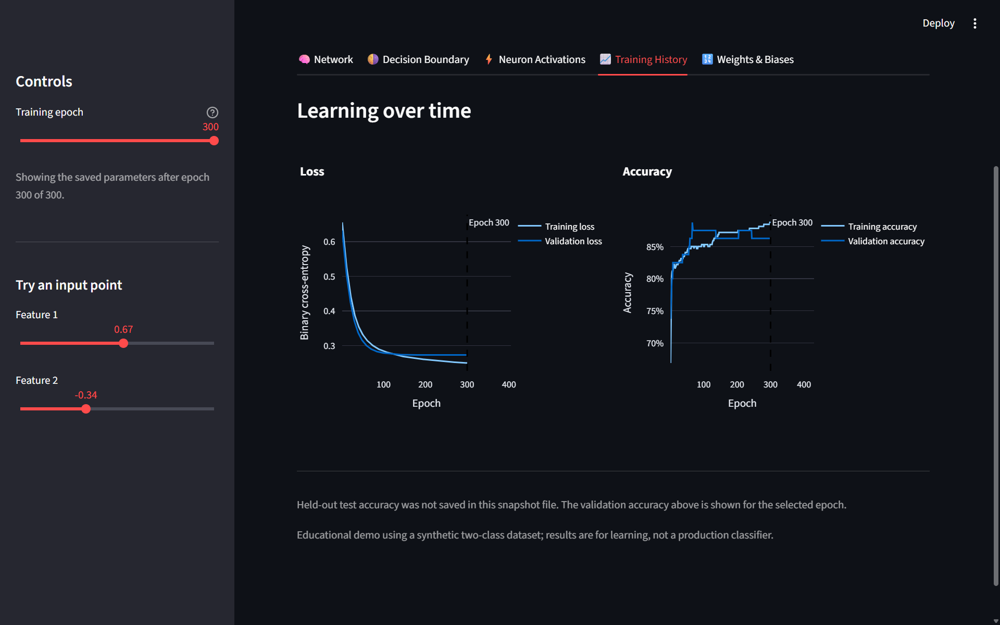
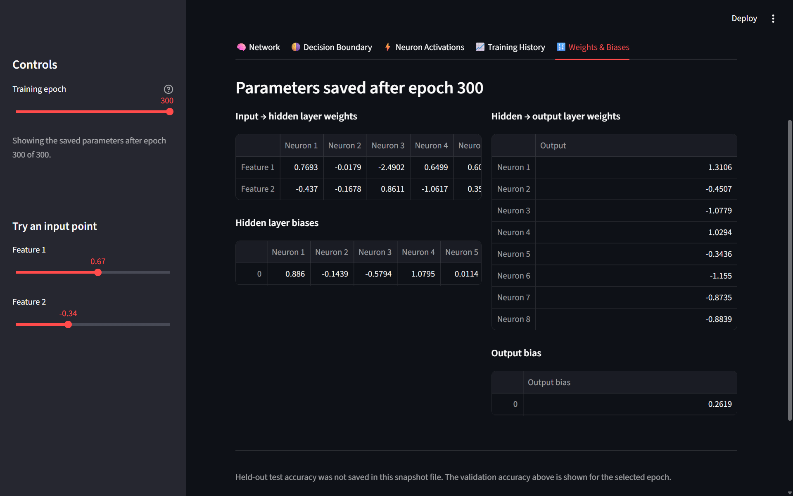
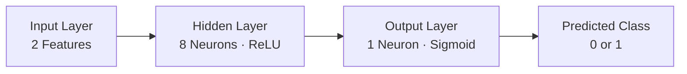

# neural-network-playground
# 🧠 Neural Network Playground

**An interactive, beginner-friendly visualization of how a neural network learns.**

Neural networks can seem complicated when you're first learning machine learning. What happens inside a hidden layer? How does a model learn from mistakes? What are weights, biases, and activation functions?

This project makes these concepts easier to understand through interactive visualizations.

Built with Python, TensorFlow, and Streamlit, Neural Network Playground demonstrates how a small neural network learns to classify data and how its internal behavior changes during training.

## ✨ Features

- **Interactive Neural Network:** Explore the network's input layer, hidden neurons, and output.
- **Decision Boundary:** See how the model separates two classes of data as it learns.
- **Neuron Activations:** Explore how hidden neurons respond to different inputs.
- **Training History:** Visualize training and validation loss and accuracy across epochs.
- **Weights and Biases:** Explore the learnable parameters that influence predictions.
- **Epoch Exploration:** Inspect saved training snapshots from different stages of learning.

## 📸 Screenshots

### 1. Network Overview

Explore the network architecture and its components.



### 2. Decision Boundary

Visualize how the neural network separates the two classes.



### 3. Neuron Activations

See how the hidden layer responds to different inputs.



### 4. Training History

Observe how loss and accuracy change during training.



### 5. Weights and Biases

Explore the parameters the network learns during training.



> **Note:** Add your actual application screenshots to the `screenshots/` folder using the filenames above. The images will appear here automatically once you push them to GitHub.

## 🧩 How Does It Work?

The project uses a small feed-forward neural network to solve a binary classification problem.

### Network Architecture



### The Three Main Parts

**1. Input Layer**

The model receives two numerical features for every data point. These features represent the point's position in a two-dimensional dataset.

**2. Hidden Layer**

The hidden layer contains eight neurons and uses the ReLU activation function. It helps the network learn patterns that cannot be captured by a simple straight-line boundary.

**3. Output Layer**

The output layer contains one neuron with a sigmoid activation function. It produces a value between 0 and 1 that represents the model's estimated probability of belonging to one of the classes.

## 📚 Concepts You Can Explore

| Concept | Simple Explanation |
|---|---|
| Neuron | A small computational unit in a neural network |
| Weight | A learnable value that controls the influence of an input |
| Bias | A learnable value that shifts a neuron's output |
| ReLU | An activation function that returns zero for negative inputs and passes positive inputs through |
| Sigmoid | An activation function that maps a value between 0 and 1 |
| Epoch | One complete pass through the training dataset |
| Loss | A numerical measure of how far predictions are from the target values |
| Accuracy | The proportion of predictions that are correct |
| Decision Boundary | The boundary separating the classes predicted by the model |

## 📊 Dataset

This project uses the **Two Moons dataset**, generated with `scikit-learn`.

The dataset contains two interleaving, crescent-shaped classes. Small amounts of noise make the classification problem more realistic.

The dataset configuration is:

- Number of samples: 500
- Input features: 2
- Classes: 2
- Noise: 0.20
- Random seed: 42

This dataset is useful for learning because the classes are not separated by a simple straight line. The model must learn a curved decision boundary.

## 🛠️ Technology Stack

- **Python** — Main programming language
- **TensorFlow / Keras** — Neural network creation and training
- **NumPy** — Numerical operations and saved parameter arrays
- **Pandas** — Data handling
- **Matplotlib** — Training and data visualizations
- **Plotly** — Interactive visualizations
- **Scikit-learn** — Dataset generation, splitting, and machine learning utilities
- **Streamlit** — Interactive web application

## 📁 Project Structure

```text
neural-network-playground/
│
├── app.py                    # Interactive Streamlit application
├── main.py                   # Dataset exploration and visualization
├── model.py                  # Neural network training
├── neural_network.keras      # Saved trained model
├── training_snapshots.npz    # Saved parameters and training history
├── requirements.txt          # Python dependencies
├── README.md                 # Project documentation
│
└── screenshots/
    ├── 01-network-overview.png
    ├── 02-decision-boundary.png
    ├── 03-neuron-activations.png
    ├── 04-training-history.png
    └── 05-weights-biases.png
```

The model and snapshot files are generated during training. Keep the required files in the repository if you want other people to run the app without training the network again.

## 🚀 Getting Started

Follow these steps to run the project on your computer.

### Prerequisites

Install Python and Git before starting.

### 1. Clone the Repository

```bash
git clone https://github.com/YOUR-USERNAME/neural-network-playground.git
cd neural-network-playground
```

Replace `YOUR-USERNAME` with the GitHub username that owns the repository.

### 2. Create a Virtual Environment

On Windows, run:

```powershell
python -m venv .venv
```

Activate it:

```powershell
.\.venv\Scripts\Activate.ps1
```

### 3. Install Dependencies

```powershell
python -m pip install --upgrade pip
pip install -r requirements.txt
```

### 4. Generate Training Files if Needed

If `neural_network.keras` or `training_snapshots.npz` is missing, train the model:

```powershell
python model.py
```

This generates the trained model and the saved information used to explore its learning process.

If both files are already included in the repository, you can skip this step.

### 5. Launch the Application

```powershell
streamlit run app.py
```

Streamlit will provide a local URL, usually:

`http://localhost:8501`

Open that address in your browser to explore the playground.

## 🎯 Learning Objectives

This project is designed to help beginners:

- Understand the basic structure of a neural network.
- Learn how activation functions influence a network.
- Observe how model parameters change during training.
- Understand training loss, validation loss, and accuracy.
- Visualize how a decision boundary develops.
- Connect machine learning theory with an interactive application.

## 🔮 Future Improvements

Some possible extensions include:

- Compare different hidden-layer sizes and architectures.
- Experiment with different activation functions.
- Add adjustable learning rates and optimizers.
- Explore additional datasets and classification problems.
- Add step-by-step training playback.
- Allow users to configure and train their own small networks.

## ⚠️ Limitations

This is an educational project built around a small synthetic dataset. Its primary goal is to make neural network concepts easier to understand.

The results on this dataset should not be interpreted as evidence of performance on real-world classification problems.

## 👨‍💻 Author

Created as a hands-on machine learning learning project to explore neural networks, model training, and interactive visualization.

If this project helps you understand neural networks, consider giving the repository a ⭐ on GitHub!
